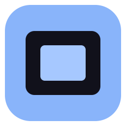
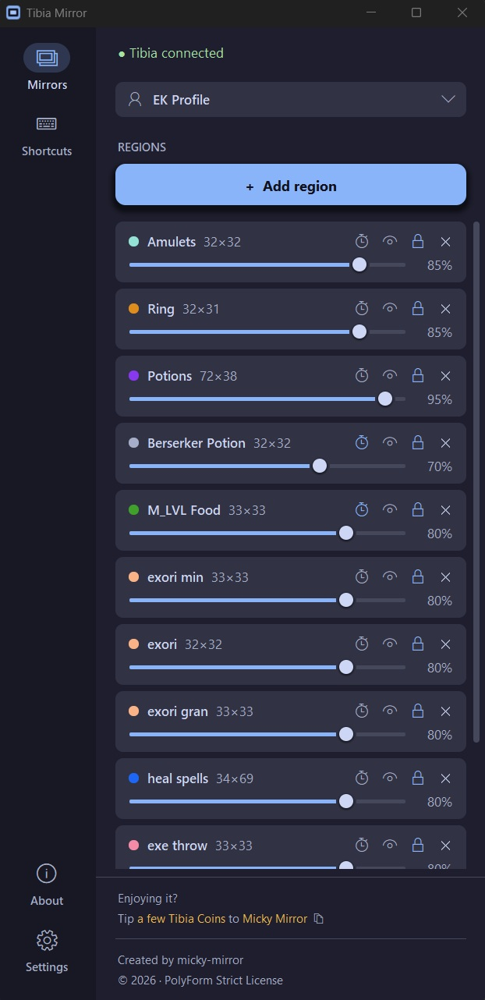
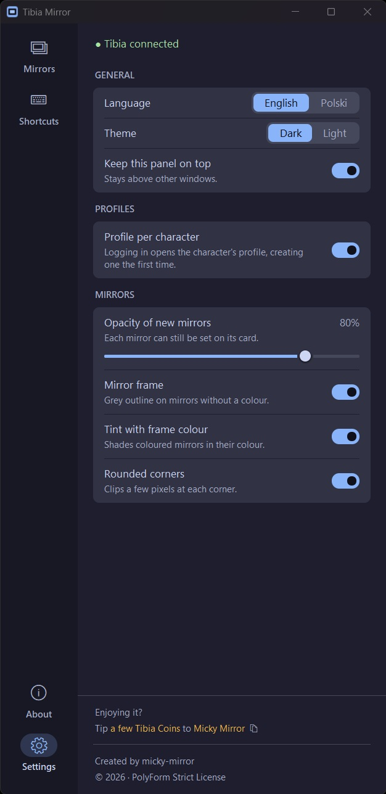
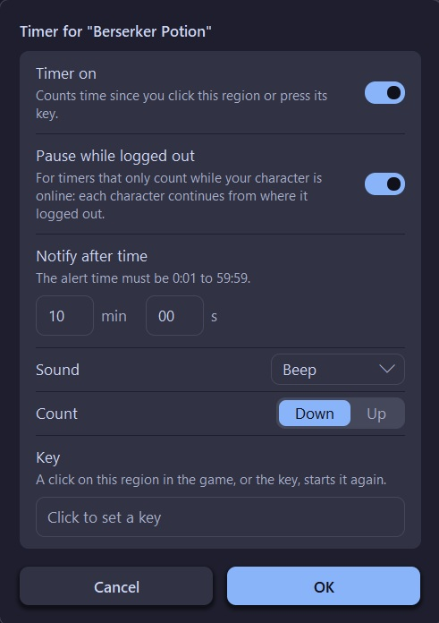

<p align="center">
  
</p>

<h1 align="center">Tibia Mirror</h1>

<p align="center">
  <b>Keep your eyes on the fight, not on the corners of the screen.</b>
  <br>
  Cooldowns, the minimap, anything you like: copied into small windows you can place anywhere.
</p>

<p align="center">
  
  
  
  
  <a href="LICENSE.md"></a>
</p>

<p align="center">
  <a href="https://github.com/micky-mirror/tibia-mirror/releases/latest/download/Tibia.Mirror.exe"></a>
</p>

<p align="center">
  
  &nbsp;
  
</p>

---

> [!NOTE]
> **Safe by design**
> - It shows what Tibia already draws, through Windows' own window previews (the same ones the taskbar uses).
> - No screen capture, no memory reading, nothing injected into the game.
> - It never clicks, types or moves the mouse for you, and never changes Tibia's window.
> - Nothing is sent anywhere.

## Quick start

Tibia Mirror runs on **Windows 11**, where it is tested.

1. Download `Tibia Mirror.exe` with the button above.
2. Start Tibia.
3. Double-click `Tibia Mirror.exe`.
4. Click **Add region**, drag a box over the part of the game you want, and name it.
5. Drag the new mirror wherever you like.

> [!TIP]
> The first time, Windows may say "Windows protected your PC", because the file isn't signed.
> Click **More info**, then **Run anyway**.

> [!NOTE]
> If Tibia runs as administrator, Tibia Mirror must run as administrator too.
> Otherwise the features that react to your keys and clicks won't work.

The app finds Tibia by itself: the panel shows "Waiting for Tibia..." until it's running, and reconnects if Tibia restarts.
Only one copy of the app runs at a time: starting it again brings the open panel to the front.
The panel opens where you left it, at the same size (smaller if it no longer fits the screen).
Every change is saved right away.

## Mirrors

### Adding a region

1. Make sure the part of Tibia you want is in view (Tibia must not be minimized).
2. Click **Add region** and drag a box over the game.
3. Name the region and press **OK** (or <kbd>Enter</kbd>).

A mirror of that region appears right next to it, ready to be dragged into place.

> [!TIP]
> While you select, a magnifier beside the pointer shows the game enlarged, with the exact pixel framed and the size of your box below it.
> The arrow keys <kbd>←</kbd> <kbd>↑</kbd> <kbd>→</kbd> <kbd>↓</kbd> shift the selected point by 1 pixel, even while the mouse button is held.
> The mouse pointer itself never moves.
> <kbd>Esc</kbd> cancels.

The app never brings Tibia to the front by itself.

### The region card

Every mirror has a card on the Mirrors page.
Hover any icon on it for a short explanation.

| On the card | What it does |
|---|---|
| Colour dot | Pick the frame colour, to tell similar mirrors apart |
| Name | Double-click to rename |
| Size, e.g. `77×83` | Select its area again (see below) |
| Stopwatch | Set up a timer (blue while on) |
| Eye | Show or hide this mirror (a hidden one stays in the list, with its name in grey) |
| Padlock | Lock it: it can't be moved and clicks go through it to the game |
| ✕ | Remove it |
| Slider | Opacity, from 10% to 100% |

### Working with a mirror

| To | Do this |
|---|---|
| Move it | Left-drag it |
| Resize it | Drag its bottom-right corner (the cursor changes there); proportions are kept |
| Remove it | Click ✕ on its card |

New mirrors start at actual size and 50% opacity, with a thin grey frame.
Zoom goes from 25% to 400%.

**Frame colours**: the picker has soft, deep, neon and dark shades, with white, silver and black.
Coloured frames are a bit thicker and always show.
Only the frame is coloured, unless **Tint with frame colour** is on in Settings.

### Selecting the area again

Click the size on a card to select that mirror's area again.
It works like adding a region: drag a box over the game, with the same magnifier and keys.
The mirror keeps its name, opacity, timer and place; only the part of the game it shows changes.

## Timers

Click the stopwatch on a card to give that mirror a timer.

<p align="center">
  
</p>

| | How it works |
|---|---|
| **Start** | Left-click the region in the game, or press the mirror's key. The next click or key press restarts it. |
| **Time** | Counts down (or up) to an alert time from 0:01 to 59:59, on a small badge just below the mirror. |
| **Time's up** | Plays the sound you picked (or none) and stays on its final value in red. A hidden mirror makes no sound. |
| **Key** | Can include <kbd>Ctrl</kbd>, <kbd>Shift</kbd> and <kbd>Alt</kbd>, like <kbd>Shift</kbd>+<kbd>F9</kbd>. It must match exactly, so <kbd>F9</kbd> alone doesn't start a <kbd>Shift</kbd>+<kbd>F9</kbd> timer. If another timer or the hide-all key has it, it moves to this timer. |

Clicks only count when they land on Tibia, and keys only while Tibia is the active window.
Timers keep running while a mirror is hidden, and start fresh when the app restarts.
Changing a timer's settings stops it, so it starts over.

> [!IMPORTANT]
> The app only reminds you: it never presses a key or clicks for you when a timer ends.

### Pause while logged out

**Pause while logged out** in the Timer dialog is on for new timers, so they only count while your character is online.
Untick it for a timer that should keep counting on the login screen.
With it on:

- On logout the timer pauses, and its badge shows the time dimmed.
- When that character logs in again, it continues from there, even after an app restart.
- Each character keeps its own progress, even on a shared profile.
- It can't be started while no one is logged in.

> [!WARNING]
> If the app is closed while you're still logged in, those timers start fresh, since the app can't know how long you stayed online.

### Hiding all mirrors

Press the hide-all key (set it on the **Shortcuts** page) while Tibia is active, and again to bring them back.
Mirrors hidden with their eye stay hidden.
While they're hidden, the top of the panel says so, e.g. "Mirrors hidden (Ctrl+H)".
Clearing the key on the **Shortcuts** page brings them back.

### When mirrors show

- Mirrors show while Tibia is in front, and hide when you switch to another app or minimize Tibia.
- In the panel they stay as they were: visible if you came from Tibia, hidden if you came from, say, a browser.
- They follow the Tibia window when it moves.
- Each mirror belongs to the game window size it was added at, e.g. windowed or fullscreen.
  At another size it hides, together with its card, and comes back when Tibia has that size again.
  To have mirrors at both sizes, add them at each size.

## Profiles

A profile is a named set of mirrors: one per character, or one for hunting and one for PvP.
Click the box at the top of the Mirrors page to switch profiles or manage them.

| Menu item | What it does |
|---|---|
| New profile | Starts empty |
| Duplicate | Copies the active profile and switches to it |
| Rename | Renames the active profile |
| Delete profile | Asks first; the last profile can't be deleted |

To move your mirrors to another PC, copy their profile files (see [Your data](#your-data)).

### Profile per character

Turn on **Profile per character** in Settings, and logging in opens the character's own profile.
The app only reads the character's name from Tibia's window title ("Tibia - Knight Name").

- The profile with the character's name opens, whatever its letter case.
- A character's first login creates that profile: a copy of the active one.
- Keep the character's name on its profile: after a rename, the next login creates a new copy.
- Turning the setting on while you're logged in opens the profile right away.
- Logging out leaves the current profile open.

## Saving

Every change is saved right away, to the active profile or to the settings.

## Settings

Settings apply immediately, except **Language** and **Theme**: they are used after a restart, and the app asks before saving them.

| Setting | What it does | Default |
|---|---|---|
| Language | English or Polish | English |
| Theme | Dark or light | Dark |
| Keep this panel on top | The panel stays above other windows | Off |
| Profile per character | Logging in opens the character's profile | Off |
| Opacity of new mirrors | Starting opacity of new mirrors | 50% |
| Mirror frame | Thin grey outline around mirrors without a colour | On |
| Tint with frame colour | Coloured mirrors are also shaded with their colour | Off |
| Rounded corners | Windows 11's rounded corners (clips a few pixels, adds a faint shadow) | Off |

## Shortcuts

| Shortcut | What it does | Default |
|---|---|---|
| Hide all mirrors | Hides every mirror, and brings them back | None |

Click the field and press the keys together; ✕ clears it.
If a timer has that key, it moves here and the timer loses it.

> [!TIP]
> Tibia receives the key too, so pick one it doesn't use.

## Your data

Profiles, settings and the error log are in `%APPDATA%\Tibia Mirror`.
Updating the `.exe` keeps them.
Each profile is a plain JSON file, safe to edit or share.

If something goes wrong, the details are in `error.log` there: errors only, never what you click or type.
If the app can't start at all, a message says so and names this file.

## License

Tibia Mirror is free to use, and its code is public to read, under the [PolyForm Strict License 1.0.0](LICENSE.md).

- ✅ Use it for any noncommercial purpose, including while streaming or recording videos, monetized ones too.
- ❌ Don't share copies, change it, or build on its code: get it from the official release page only.
- ❌ Contributions are not accepted.

The streaming permission, and the licenses of the open-source software inside the `.exe`, are in [NOTICE.md](NOTICE.md).

<sub>Tibia is a trademark of CipSoft GmbH; this fan-made tool is not affiliated with or endorsed by CipSoft.</sub>

---

<details>
<summary><b>For developers</b></summary>

### Running from source

Windows 11 and Python 3.10 or newer; no third-party packages are needed to run it.

```
python main.py
```

A run from source shares its data with the `.exe`.

### Checks

Install the dev tools into the project virtual environment, then run the checks:

```
.venv\Scripts\python -m pip install --group dev
.venv\Scripts\python -m pytest
.venv\Scripts\python -m ruff check .
.venv\Scripts\python -m ruff format --check .
.venv\Scripts\python -m mypy
```

The code is fully type-annotated and mypy runs in strict mode.

### Building the .exe

```
.venv\Scripts\python -m PyInstaller "Tibia Mirror.spec"
```

This makes a single `dist\Tibia Mirror.exe` with the icon, name, version and copyright in its Properties.
The version comes from `tibia_mirror/__init__.py`; keep `pyproject.toml` in step (a test checks this).

### Project layout

```
main.py                      entry point
Tibia Mirror.spec            the .exe build (PyInstaller)
tibia_mirror/
  app.py                     App: starts its parts and connects them
  config.py                  paths, sizes, poll intervals
  i18n.py                    English and Polish text
  about.py                   author, contact, tip character, copyright years
  errors.py                  the error log
  app_parts/                 the parts App is built from
    app_window.py            the main window
    tibia_connection.py      finding Tibia, its window and who is logged in
    front_window_tracker.py  the window the user works in
    profile_manager.py       the profiles, and the one that is open
    mirror_manager.py        the mirror windows on screen
    timer_manager.py         the timers that count, and their paused progress
    input_watcher.py         the clicks and key presses, passed on to App
    settings_writer.py       writing settings.json
  core/                      pure logic: no Windows or Tk code
    geometry.py              pure coordinate math
    game_window.py           the Tibia window as the app sees it
    connection.py            the states of the connection to Tibia
    profile.py               one profile, as it is saved in its file
    mirror_settings.py       the settings of one mirror
    mirror_timer.py          the timer of one mirror and what its badge shows
    mirror_look.py           how every mirror is drawn
    regions.py               layouts, window sizes, ids and default names
    profiles.py              the rules for profile names
    timers.py                key combinations and paused progress per character
    characters.py            the character in Tibia's window title
    handles.py               the Hwnd name for window handles
  settings/                  the settings of the app
    app_settings.py          the settings, as they are saved in settings.json
    app_settings_store.py    the settings while the app runs
  winapi/                    everything that calls Windows
    win32.py                 ctypes bindings and window helpers
    dwm.py                   DWM thumbnail wrapper (the core mechanism)
    tibia.py                 finding the Tibia client window
    rawinput.py              the hidden window that hears clicks and keys (Raw Input)
    instance.py              one copy at a time
    sounds.py                timer alert sounds
  assets/icon.ico            the app icon
  ui/                        everything drawn with Tk
    base/                    themes, display scaling, shape rendering, helpers
    overlay/                 mirror window and frame, timer badge, selection overlay, magnifier
    panel/                   the panel: menu rail, pages, mirror cards, profile menu, card rows
      controls/              popups, dropdowns, slider, tooltips and other widgets
tests/                       unit tests for the non-GUI modules
docs/                        architecture, images
```

### Documentation

- [Architecture](docs/architecture.md): how the app works and how the modules fit together.

</details>
