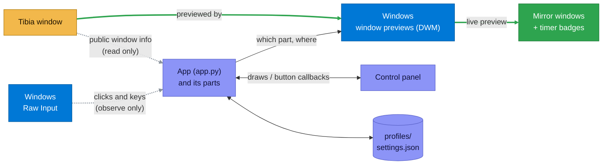

# Architecture

A short tour of how Tibia Mirror works.
For the details, follow the file names into the code.

## Overview

Windows itself draws a live preview of Tibia inside each mirror, the same way the taskbar previews windows.
The app never receives the game's image: it only tells Windows which part of Tibia to show, and where.

The app knows Tibia only from what Windows shows every program about any window, as the taskbar and Alt+Tab do: its title, whether it's minimized, and where it is, so the mirrors can follow it.
To make sure the window is really Tibia, it also reads the program's file path, using the lowest access level Windows offers (`PROCESS_QUERY_LIMITED_INFORMATION`), which gives no access to the game's memory.

- **`App`** (`app.py`) starts the parts and connects them.
  Its methods tell the story of each action: they check, call the parts, and show the result.
  Its only state of its own is whether the hide-all key hides the mirrors.
- **The parts** (`app_parts/`) each own one piece of the running app:
  - `AppWindow`: the main window, its place, size and theme, closing, and coming to the front at a second start.
  - `TibiaConnection`: finds Tibia, follows its window, and reads who is logged in.
    It tells the App what changed.
    It uses `Game` (in the same file) for the window and `FrontWindowTracker` for the window the user works in.
  - `ProfileManager`: the profiles, the open one and its mirrors.
  - `MirrorManager`: the mirror windows on the screen, and new mirrors.
  - `TimerManager`: when each timer started, and its paused progress at a logout.
  - `SettingsWriter`: writes `settings.json` shortly after a change.

  Only `app.py` uses the parts.
  A part gets every object it uses in its constructor, and never imports `app.py`.
- **The UI** (`ui/`) draws what the App gives it and calls back into the App.
  The Settings and Shortcuts pages change the settings themselves.
- **Pure logic** (`core/`, the settings in `settings/`, and the shapes in `ui/base/render.py`) has no Windows or Tk code, so it is unit-tested.
  The parts are tested too, with small fakes in place of Tk and Tibia.

## Mirrors: DWM thumbnails

The app never captures the screen.
It asks the Windows compositor (DWM) to draw a live copy of part of Tibia's window into a mirror window (`dwm.Thumbnail`), the same way the taskbar shows window previews.

- The copy is live and costs nothing: there is no refresh loop.
- The app never receives the game's image.
- It works with Tibia in real fullscreen, where screen capture shows a black image.

Each mirror (`ui/overlay/mirror_window.py`) is a borderless, always-on-top window:

- **Opacity** is the window's alpha, which also applies to the copied image.
- **Locked** mirrors are click-through, so clicks reach the game.
- **The frame** is the window's own background, around the copied image.
- **Rounded corners** use Windows 11's own rounding, the only kind that also clips the image.
  The frame is then a second window behind the image (`ui/overlay/mirror_frame.py`), cut into a rounded ring.
- **A tint** uses that second window too: it stays solid in the frame colour, so the colour shows through the see-through image.
- **Timer badges** (`ui/overlay/timer_badge.py`) are small windows of their own just below the mirror, since nothing can be drawn over the copied image.

### Layouts per window size

Tibia's panels don't scale with its window, so a mirror keeps one **layout per client size** (e.g. windowed and fullscreen).
A layout (`core/regions.py`) is the region shown plus the mirror's position relative to the game window, so mirrors follow Tibia when it moves.
Adding a region makes a layout for the size Tibia has at that moment.
A mirror without a layout for the current size is not shown, and the Mirrors page leaves out its card.

## Finding Tibia

`winapi/tibia.py` looks for a window whose title starts with "Tibia" and whose program is `...\Tibia\bin\client.exe`.
The title alone isn't enough: other windows (an editor, the app's own panel) can contain "Tibia" too.
Reading the program's path uses the lowest access level Windows offers (`PROCESS_QUERY_LIMITED_INFORMATION`), which gives no access to the game's memory.

- `TibiaConnection` (`app_parts/tibia_connection.py`) looks again every 200 ms (`CONNECTION_POLL_MS`).
  Until Tibia is found, the panel shows "Waiting for Tibia...".
- When Tibia closes, the mirrors keep their settings and reconnect to the new window once Tibia starts again.
- A minimized Tibia has no client area, so mirrors hide until it's restored.
- `Game` (in `app_parts/tibia_connection.py`) remembers the window and its client area.
  At each check, `TibiaConnection` also reads who is logged in, from the window title.
  It tells the App when the state, the game window or the character changed, and the App decides what to do.

## When mirrors show

Mirrors should show while the player is looking at Tibia:

- `FrontWindowTracker` (`app_parts/front_window_tracker.py`) keeps the last window in front, leaving out the app's own windows and the taskbar and Alt+Tab windows.
  So while the panel or a dialog is in front, the window before it decides: coming from Tibia keeps the mirrors visible, coming from a browser keeps them hidden.
- `TibiaConnection` reads it at each check, so `GameWindow.is_in_front` changes and the mirrors follow.
- A mirror window (`MirrorWindow._show_at_saved_place`) shows only while Tibia is in front and not minimized, the mirror isn't hidden, and it has a layout for the current size.
- The App closes every mirror window when a region selection starts (`App._on_select_area`), and while the hide-all key is active (`App._show_mirrors`).

## Input and timers

Clicks and key presses come from Windows **Raw Input** (`winapi/rawinput.py`), which only observes: it can't block, change or send input.

> [!WARNING]
> Raw Input messages arrive inside Tk's event loop, and calling Tk from there crashes Python.
> So the watcher only queues each event, and a short Tk timer hands the queue to the App.
> Python's garbage collector can also run there, and if it frees Tk images then, Python crashes too.
> That is why a new theme or language is used after a restart, instead of building the panel again while the app runs.

- A left click starts the timers whose region it hits, but only if it landed on Tibia.
- A key starts the timers bound to exactly that combination, but only while Tibia is in front.
- A key combination does one thing only.
  Setting a key in one place clears it everywhere else (`ProfileManager.clear_hotkey`), and a profile that is opened loses the hide-all key from its timers.
- The timer logic is pure: `core/mirror_timer.py` has a timer's settings and what its badge shows, and `core/timers.py` has key combinations and paused progress.
- `TimerManager` (`app_parts/timer_manager.py`) keeps when each timer started.
  The App passes it the clicks and keys, and `MirrorManager.update_timer_badges` shows the times on the badges every 200 ms (`TIMER_TICK_MS`).
- A mirror window plays the timer's sound when its time is up, but not while the mirror is hidden.

**Pause while logged out**: `TibiaConnection` reads the logged-in character from Tibia's window title ("Tibia - Name").
The start times of running timers are kept in memory.
At a logout they become paused progress in `settings.json`, per character and per mirror id, and they continue at the next login.
While nobody is logged in, a paused timer shows its time dimmed.

## Profiles and settings

- **Profiles** (`core/profile.py`, `core/mirror_settings.py`, `core/mirror_timer.py`) are JSON files, one per profile, in `%APPDATA%\Tibia Mirror\profiles`.
  Each mirror has a permanent hidden `id`, a name, opacity, zoom, colour, timer and its layouts.
  Files of v1.0.0 load as they are, and tests pin that format.
- **The open profile** is kept by `ProfileManager` (`app_parts/profile_manager.py`), which also does new, duplicate, rename and delete.
  Every change is written to the file at once.
  A duplicate gives its mirrors new ids, so paused timers never mix between profiles.
  A file that can't be read opens as an empty profile, and the panel says so.
- **Profile names** are file names, so they follow Windows' rules and compare ignoring case (`core/profiles.py`).
- **Settings** (`settings/app_settings.py`) are saved to `settings.json`.
  Bad or unknown values fall back to defaults, so a hand-edited file never stops the app from starting.
  `AppSettingsStore` (`settings/app_settings_store.py`) holds them while the app runs, and tells the App and the pages that listen after each change.
  `SettingsWriter` writes the file shortly after a change, and once more when the window closes.
- **Profile per character**: at a login, the App opens the profile with the character's name, or makes one as a copy of the open profile.

## The control panel

The panel is plain Tk, made to look modern without third-party packages:

- **Rounded, anti-aliased shapes and shadows** (buttons, cards, fields) are drawn in code in `ui/base/render.py` and cached.
- **Mirror cards, the menu rail and the cards of settings rows** are drawn on one canvas each and hit-tested by position, for clean hover handling.
- **Themes** (`ui/base/theme.py`): colours are read when a widget is drawn, never copied at import time.
  A new theme or language is used after a restart: the Settings page asks first, and nothing is built again while the app runs (see "Input and timers").
- **Languages** (`i18n.py`): every user-facing text goes through `tr()`; a test fails if any has no Polish translation.
- **Size and place**: the first time, the panel opens centred, tall enough for the whole Settings page, and shorter on small screens (pages scroll).
  After that it opens where it was last, its size shrunk to fit the screen if needed (`panel_rect` in `settings.json`).
- **Display scaling** (`ui/base/scale.py`): Tk scales fonts with Windows' display scaling, but not pixel sizes.
  So every size is written as its value at 100% and goes through `px()` where it is used, so boxes grow with their text.
  The scale is read once at startup from Tk, and the theme's button styles are built after it.
  Game coordinates (regions, mirror positions and sizes) never go through `px()`.
  Rounded shapes are rendered at the scaled size, so they stay sharp; rows of a shape's straight middle are identical, so each is computed once.

## Startup, data and errors

1. **One copy at a time** (`winapi/instance.py`): a named mutex marks the running copy.
   A second copy signals it to show its panel, and quits before touching any data.
2. **Error log** (`errors.py`): the `.exe` has no console, so errors go to `error.log` through Python's `logging`.
   At 1 MB the log moves to `error.log.1` and a new one starts.
   Errors in Tk callbacks come in through `AppWindow.report_callback_exception`.
   If the app can't even open its panel, a message box names the log.
3. **Data** lives in `%APPDATA%\Tibia Mirror`, shared by the `.exe` and a run from source.

The `.exe` is built with PyInstaller from `Tibia Mirror.spec` (single file, no console, no UPX, which antivirus programs dislike).
It leaves out standard-library parts the app never runs (OpenSSL, sockets, compression, `decimal`), so it ships no network code; `NOTICE.md` lists the open-source software it does include.

## Safety rules

These are deliberate and must stay true:

- Nothing reads or changes the game's memory or files.
- Nothing moves the mouse pointer or sends input: no `SetCursorPos`, `SendInput` or `mouse_event`.
- Nothing changes Tibia's window; the app only reads the public window info every program can see, and shows the window through DWM.
- Timers only alert: they never press keys or click when they end.
- Nothing is sent over the network.

## Code map

| Area | Files |
|---|---|
| App and startup | `app.py`, `main.py`, `errors.py`, `config.py` |
| App parts | `app_parts/app_window.py`, `app_parts/tibia_connection.py`, `app_parts/front_window_tracker.py`, `app_parts/profile_manager.py`, `app_parts/mirror_manager.py`, `app_parts/timer_manager.py`, `app_parts/settings_writer.py` |
| Settings | `settings/app_settings.py`, `settings/app_settings_store.py` |
| Windows and Tibia | `winapi/win32.py` (all Win32 calls), `winapi/dwm.py`, `winapi/tibia.py`, `winapi/rawinput.py`, `winapi/instance.py`, `winapi/sounds.py` |
| Pure logic | `core/geometry.py`, `core/game_window.py`, `core/connection.py`, `core/profile.py`, `core/mirror_settings.py`, `core/mirror_timer.py`, `core/mirror_look.py`, `core/regions.py`, `core/profiles.py`, `core/timers.py`, `core/characters.py`, `core/handles.py` |
| Text | `i18n.py`, `about.py` |
| Mirrors | `ui/overlay/mirror_window.py`, `ui/overlay/mirror_frame.py`, `ui/overlay/timer_badge.py`, `ui/overlay/selection_overlay.py`, `ui/overlay/loupe.py`, `ui/overlay/pixel_marker.py` |
| Panel | `ui/panel/panel.py`, `ui/panel/nav.py`, `ui/panel/footer.py`, the pages in `ui/panel/pages/`, the mirror cards and the timer dialog in `ui/panel/mirrors/`, the profile picker and menu in `ui/panel/profiles/`, the rows of the cards in `ui/panel/rows/` |
| Widgets | `ui/panel/controls/` |
| Drawing | `ui/base/render.py`, `ui/base/theme.py`, `ui/base/scale.py`, `ui/base/images.py`, `ui/base/text.py`, `ui/base/windows.py` |
